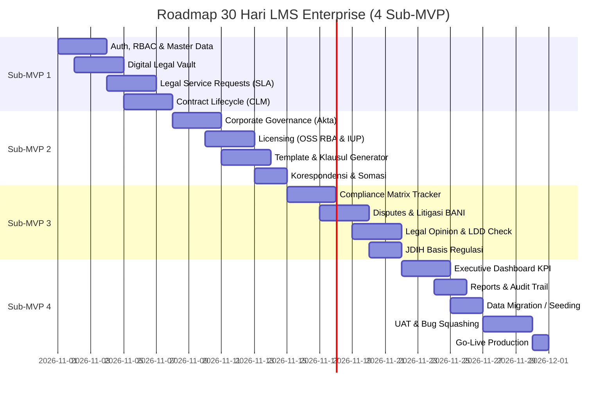

# DOKUMEN SPESIFIKASI DETAIL TIMELINE 30 HARI (4 SUB-MVP)
## ELegal Enterprise Legal Suite (web-legal)
**Target Pelaksanaan:** 30 Hari Kalender (4 Minggu Iteratif)  
**Pendekatan:** *Lean, Deterministic Business Logic (Zero AI Overhead), Data-Dependency Aware*  
**Ruang Lingkup:** 15 Modul Operasional (Modul Tender dialokasikan khusus pada Fase 2)

---

## DAFTAR ISI ROADMAP
1. [Sub-MVP 1 (Hari 1–7): Foundation, Intake & Core Contract Operations](#sub-mvp-1-hari-17-foundation-intake--core-contract-operations)
2. [Sub-MVP 2 (Hari 8–14): Corporate Governance, Licensing & Legal Drafting](#sub-mvp-2-hari-814-corporate-governance-licensing--legal-drafting)
3. [Sub-MVP 3 (Hari 15–21): Compliance, Disputes & Legal Analysis](#sub-mvp-3-hari-1521-compliance-disputes--legal-analysis)
4. [Sub-MVP 4 (Hari 22–30): Executive Aggregation, Audit Trail, UAT & Go-Live](#sub-mvp-4-hari-2230-executive-aggregation-audit-trail-uat--go-live)
5. [Matriks Checklist Deliverable & Sign-off PM](#matriks-checklist-deliverable--sign-off-pm)

---



---

## SUB-MVP 1 (HARI 1–7): Foundation, Intake & Core Contract Operations
> **Tema Utama:** *"Menertibkan Pintu Masuk Permintaan & Sentralisasi Arsip Kontrak"*  
> **Fokus Data:** Membangun entitas hulu master, autentikasi sesi, alur tiket permohonan antar-divisi, registrasi kontrak, dan repositori berkas asli.

### 1. Modul Pengaturan & Akses Pengguna (`settings`)
* **Fitur & Spesifikasi:**
  * **Multi-Entity Switcher:** Pemilihan entitas aktif perseroan (*PT Nusantara Energi, PT Nusantara Holdings Utama, PT Sinergi Tambang Gemilang*).
  * **Role-Based Access Control (RBAC):** Pemetaan 6 peran baku: `Superadmin`, `General Counsel`, `Legal Counsel`, `Contract Drafter`, `Business Unit Requester`, `Auditor`.
  * **Konfigurasi Kuota & Backup:** Ekspor/Impor cadangan data format JSON untuk ketahanan operasional.
* **Aturan Bisnis (Business Rules):**
  * Setiap data transaksi yang dibuat wajib otomatis menempelkan `entity_id` aktif dan `created_by` sesuai sesi login.

### 2. Modul Master Data (`master-data`)
* **Fitur & Spesifikasi:**
  * **Buku Rekanan (*Counterparty Master*):** Pencatatan nama perusahaan mitra, NIK/NPWP, alamat domisili hukum, PIC kontak, dan klasifikasi vendor.
  * **Kategori Hukum:** Klasifikasi jenis perjanjian (*PPA, EPC, Jasa Penambangan, Sewa Alat, Pasokan Batubara, NDA*).
  * **Daftar PIC Legal Counsel:** Daftar pengacara internal perseroan beserta email dan kapasitas beban kerja aktif.

### 3. Modul Digital Legal Vault (`documents`)
* **Fitur & Spesifikasi:**
  * **Penyimpanan Berkas Terpusat:** Upload file PDF/Word ke cloud storage (*AWS S3 / MinIO / Local Secure Bucket*).
  * **Metadata Berkas:** Penandaan nomor berkas, kategori, tag retensi hukum (*Legal Hold*), dan tanggal unggah.
  * **Pratinjau Dokumen:** Penampil berkas PDF langsung di dalam browser tanpa harus mengunduh file.
* **Aturan Bisnis (Business Rules):**
  * Maksimal ukuran berkas 15 MB per dokumen.
  * Validasi tipe MIME ketat (hanya `.pdf`, `.docx`, `.xlsx`).

### 4. Modul Permohonan Layanan Legal (`requests`)
* **Fitur & Spesifikasi:**
  * **Formulir Pengajuan Tiket:** Input judul permohonan, divisi pemohon, tingkat urgensi (*Normal, High, Urgent*), batas waktu yang diharapkan, deskripsi latar belakang, dan lampiran draf awal.
  * **Auto-Numbering Generator:** Format baku `REQ-YYYY-XXXX` (contoh: `REQ-2026-0042`).
  * **Workflow Penugasan PIC:** Legal Head dapat menugaskan (*assign*) tiket ke Legal Counsel tertentu.
  * **SLA Countdown Timer:** Perhitungan sisa hari kerja otomatis berbasis jam kerja (SLA 3 hari kerja untuk review standar, 1 hari untuk *Urgent*).
  * **Transisi Status:** `SUBMITTED` $\rightarrow$ `ASSIGNED` $\rightarrow$ `IN_REVIEW` $\rightarrow$ `REVISION_REQUIRED` $\rightarrow$ `COMPLETED`.
* **Aturan Bisnis (Business Rules):**
  * Tiket yang melewati tanggal batas waktu otomatis berstatus `OVERDUE` dan memicu badge merah.

### 5. Modul Manajemen Kontrak / CLM (`contracts`)
* **Fitur & Spesifikasi:**
  * **Formulir Registrasi Kontrak:** Nomor kontrak internal/eksternal, judul perjanjian, relasi ke rekanan (*Counterparty*), tanggal efektif, tanggal berakhir, nilai komitmen moneter (IDR/USD), dan termin pembayaran.
  * **Manajemen Klausul Kritis:** Pencatatan ringkasan klausul denda wanprestasi, forum penyelesaian sengketa, dan ketentuan terminasi sepihak.
  * **Pencatatan Riwayat Adendum:** Fitur tambah adendum dinamis (perubahan jangka waktu, adendum nilai kontrak, perubahan ruang lingkup kerja).
  * **Tautan Berkas Digital:** Integrasi langsung ke berkas PDF final yang tersimpan di *Digital Vault*.
  * **Ekspor CSV:** Unduh rekapitulasi register kontrak dengan sanitasi formula kebal eksploitasi CSV injection.
* **Kriteria Penerimaan (DoD) Minggu 1:**
  * Staf Unit Bisnis berhasil submit permohonan telaah kontrak.
  * Legal Counsel bisa menerima tiket, memproses telaah, dan mendaftarkan hasilnya menjadi data Kontrak Aktif berlampiran PDF.

---

## SUB-MVP 2 (HARI 8–14): Corporate Governance, Licensing & Legal Drafting
> **Tema Utama:** *"Legalitas Korporasi, Proteksi Izin Operasional, & Standardisasi Surat"*  
> **Fokus Data:** Manajemen akta notaris, struktur pemegang saham, izin tambang/OSS, dan otomasi draf dokumen legal.

### 6. Modul Tata Kelola Korporat (`corporate`)
* **Fitur & Spesifikasi:**
  * **Profil Legalitas Perseroan:** Nomor Induk Berusaha (NIB), NPWP Badan, Alamat Domisili, dan Klasifikasi Baku Lapangan Usaha (KBLI).
  * **Register Akta & SK Notaris:** Pencatatan Akta Pendirian, Akta Perubahan Anggaran Dasar, Nama Notaris, Tanggal Terbit, dan Nomor SK Kemenkumham RI.
  * **Buku Daftar Pemegang Saham (*Cap Table*):** Persentase kepemilikan modal, jumlah lembar saham, nominal modal disetor, serta identifikasi *Beneficial Ownership*.
  * **Susunan Direksi & Komisaris:** Periode masa jabatan aktif pengurus, NIK, dan batas kewenangan tanda tangan perbankan/kontrak.

### 7. Modul Perizinan Berusaha (`licensing`)
* **Fitur & Spesifikasi:**
  * **Register Izin Usaha:** Inventarisasi izin OSS RBA, PB-UMKU, Izin Usaha Pertambangan (IUP), Sertifikat Laik Operasi (SLO), dan AMDAL/SKKL.
  * **Instansi Penerbit:** Kementerian ESDM, BKPM, KLHK, Kemenhub, Pemda.
  * **Mesin Notifikasi Masa Berlaku (Deterministik):**
    * `Aman`: Masa berlaku $> 90$ hari (Badge Hijau).
    * `Siaga`: Masa berlaku $31 - 90$ hari (Badge Kuning).
    * `Kritis`: Masa berlaku $\le 30$ hari atau telah kedaluwarsa (Badge Merah).
  * **Unggah Salinan Izin:** Link langsung ke dokumen PDF izin di *Vault*.

### 8. Modul Template & Klausul Baku (`templates`)
* **Fitur & Spesifikasi:**
  * **Katalog Template Baku:** Somasi Wanprestasi (Somasi 1 & 2), Perjanjian Kerahasiaan (NDA), Surat Kuasa Khusus, Memo Hukum Standar.
  * **Generator Variabel Cerdas (*Merge Fields*):**
    * Input variabel: `{nomor_surat}`, `{nama_mitra}`, `{nilai_klaim}`, `{dasar_kontrak}`, `{tenggat_waktu_hari}`.
    * Pratinjau draf teks real-time dua kolom (kolom kiri form variabel, kolom kanan pratinjau surat).
  * **Pilihan Klausul Pilihan (*Clause Picker*):** Sisipkan klausul forum arbitrase BANI atau Pengadilan Negeri secara modular.
  * **Ekspor Draf:** Cetak langsung atau salin teks ke clipboard/format cetak.

### 9. Modul Korespondensi Legal (`correspondence`)
* **Fitur & Spesifikasi:**
  * **Buku Agenda Surat Masuk & Keluar:** Klasifikasi surat eksternal, tanggal diterima/dikirim, pengirim, perihal surat, dan disposisi tindakan.
  * **Pelacak Somasi Terbit:** Pemantauan tenggat waktu respon somasi (standar 7 hari atau 14 hari kalender) dengan penanda status (*Telah Direspon / Tidak Diindahkan*).
* **Kriteria Penerimaan (DoD) Minggu 2:**
  * Seluruh data legalitas akta dan pemegang saham grup perseroan terdokumentasi rapi.
  * Filter izin berdasarkan masa berlaku dapat memisahkan izin yang harus segera diperpanjang.
  * Pembuatan draf surat somasi dan NDA dapat selesai dalam < 2 menit melalui generator template.

---

## SUB-MVP 3 (HARI 15–21): Compliance, Disputes & Legal Analysis
> **Tema Utama:** *"Mitigasi Risiko Litigasi, Kepatuhan Regulasi, & Kajian Mendalam"*  
> **Fokus Data:** Pengawasan sengketa hukum di forum peradilan, matriks kewajiban lingkungan/ketenagakerjaan, serta audit uji tuntas.

### 10. Modul Kepatuhan Regulasi (`compliance`)
* **Fitur & Spesifikasi:**
  * **Matriks Kewajiban Berkala:** Pelaporan LKPM BKPM (Triwulanan), Laporan RKL-RPL Lingkungan Hidup (Semesteran), Pelaporan WLKP Ketenagakerjaan (Tahunan).
  * **Status Kepatuhan Interaktif:** Toggle status per periode: `COMPLIANT`, `IN_PROGRESS`, `OVERDUE`.
  * **Bukti Tanda Terima:** Unggah file Bukti Tanda Terima Elektronik (BTE) sebagai verifikasi bahwa laporan telah diterima kementerian.

### 11. Modul Sengketa & Litigasi Korporasi (`disputes`)
* **Fitur & Spesifikasi:**
  * **Register Perkara Hukum:** Nomor perkara (contoh: `45021/I/ARB-BANI/2026` atau `102/Pdt.G/2026/PN.Jkt.Sel`), klasifikasi forum (PN, PT, MA, Arbitrase BANI/SIAC, PHI).
  * **Posisi Perseroan:** Penggugat, Tergugat, Pemohon, Termohon, Turut Tergugat.
  * **Kalkulasi Eksposur Finansial:** Input nilai klaim gugatan materiil dan imateriil. Sistem otomatis menjumlahkan total eksposur risiko per forum perkara.
  * **Agenda Sidang:** Tanggal sidang berikutnya, agenda (Pemeriksaan Saksi, Replik, Duplik, Putusan), dan nama kuasa hukum eksternal (*Litigation Lawyer*).
  * **Status Putusan:** `BERJALAN`, `BANDING`, `KASASI`, `INKRACHT (Berkekuatan Hukum Tetap)`.

### 12. Modul Kajian Opini Hukum (`opinions`)
* **Fitur & Spesifikasi:**
  * **Format Kajian Hukum 6 Seksi Baku:**
    1. Latar Belakang Masalah (*Background*)
    2. Identifikasi Isu Hukum (*Legal Issues*)
    3. Fakta-Fakta Material (*Material Facts*)
    4. Analisis Yuridis & Landasan Aturan (*Legal Analysis*)
    5. Kesimpulan (*Conclusion*)
    6. Rekomendasi Mitigasi Risiko (*Recommendations*)
  * **Paraf Berjenjang:** Alur persetujuan internal dari drafter ke Senior Legal Counsel dan General Counsel.

### 13. Modul Legal Due Diligence / Uji Tuntas (`ldd`)
* **Fitur & Spesifikasi:**
  * **Checklist Audit 6 Pilar:**
    * Pilar 1: Legalitas Korporasi & Akta
    * Pilar 2: Aset, Tanah & Fasilitas Produksi
    * Pilar 3: Perjanjian Komersial Material
    * Pilar 4: Ketenagakerjaan & Serikat Pekerja
    * Pilar 5: Perizinan Lingkungan & Teknis
    * Pilar 6: Riwayat Litigasi & Klaim Pihak Ketiga
  * **Penilaian Risiko Cepat:** Toggle status per poin: `OK`, `FLAG (Temuan Berisiko)`, `N/A`.
  * **Indikator Temuan Merah (*Red Flag Alert*):** Rekomendasi mitigasi klausul ganti rugi (*indemnity*).

### 14. Modul Basis Pengetahuan / JDIH (`knowledge`)
* **Fitur & Spesifikasi:**
  * **Pustaka Peraturan:** Katalog UU, PP, Peraturan Menteri ESDM, KLHK, Kemenaker, dan Yurisprudensi Putusan MA.
  * **Pencarian Cepat:** Filter berdasarkan kata kunci nomor regulasi atau sektor industri.
* **Kriteria Penerimaan (DoD) Minggu 3:**
  * Tim legal dapat melacak seluruh agenda sidang dan nilai eksposur sengketa terhitung otomatis.
  * Matriks kepatuhan pelaporan pemerintah memiliki status pemenuhan yang jelas.
  * Alur pembuatan opini hukum dan checklist LDD berfungsi secara lengkap.

---

## SUB-MVP 4 (HARI 22–30): Executive Aggregation, Audit Trail, UAT & Go-Live
> **Tema Utama:** *"Sentralisasi Dashboard Eksekutif, Uji Coba Pengguna (UAT), & Peluncuran"*  
> **Fokus Data:** Menghubungkan seluruh data transaksi ke dashboard eksekutif, rekapitulasi laporan Direksi, migrasi data lama, dan serah terima.

### 15. Modul Dashboard Eksekutif (`dashboard`)
* **Fitur & Spesifikasi:**
  * **6 Kartu Metrik KPI Utama:**
    1. Total Permintaan Aktif (tiket yang butuh telaah).
    2. Overdue SLA (tiket yang melewati batas waktu target).
    3. Total Kontrak Aktif Berjalan.
    4. Kontrak Masa Siaga $\le 30$ Hari (butuh tindakan perpanjangan/adendum).
    5. Persentase Kepatuhan Regulasi (% kepatuhan periode berjalan).
    6. Total Eksposur Nilai Sengketa BANI/Litigasi (dalam Rupiah).
  * **Urgent Contracts Watchlist:** Tabel kontrak berisiko tinggi yang jatuh tempo dalam 30 hari ke depan dengan sisa hari real-time.
  * **Kalender Sidang & Agenda Hukum:** Jadwal terdekat untuk sidang pengadilan dan batas akhir pelaporan berkala.

### 16. Modul Laporan & Rekapitulasi (`reports`)
* **Fitur & Spesifikasi:**
  * **Agregasi Portofolio:** Rekapitulasi nilai komitmen kontrak per unit bisnis dan anak perusahaan.
  * **Laporan Kepatuhan Korporat:** Ringkasan kesiapan audit berkala.
  * **Ekspor Terpadu:** Cetak laporan ringkas PDF / Ekspor CSV untuk bahan rapat Dewan Komisaris dan Direksi.

### 17. Modul Audit Trail & Log Aktivitas (`activity`)
* **Fitur & Spesifikasi:**
  * **Pencatatan Tanpa Celah:** Merekam setiap aksi `CREATE`, `UPDATE`, `DELETE`, `APPROVE`, `EXPORT`.
  * **Metadata Log:** Menampilkan Nama Karyawan, Role, Waktu Kejadian (*Timestamp*), IP Address/Device, dan Deskripsi Detail Tindakan.

---

### 🚀 Timeline Aktivitas Akhir Menuju Peluncuran (Hari 25 – 30)

```
Hari 25 ────► Hari 26 ────► Hari 27 ────► Hari 28 ────► Hari 29 ────► Hari 30
Data Seeding  Verifikasi    Sesi UAT     UAT Sign-off Bug Fix &     GO-LIVE
(Impor Excel  Integritas    (Tim Legal   Feedback     Performance   PRODUCTION
Data Eksisting) Data Relasi & Bisnis)    Penyesuaian  Optimization  & BAST
```

* **Hari 25–26: Migrasi Data Eksisting (*Data Seeding*):**
  * Mengisi data master entitas, master rekanan, arsip izin aktif, dan kontrak berjalan dari file spreadsheet eksisting tim legal.
* **Hari 27–28: Pelaksanaan User Acceptance Testing (UAT):**
  * Pengujian skenario menyeluruh oleh *Key Users* (General Counsel, staf legal, perwakilan divisi bisnis).
  * Penandatanganan Berita Acara UAT.
* **Hari 29: Perbaikan Isu Minor (*Bug Squashing*):**
  * Penyesuaian label UI minor, perbaikan bug tampilan, dan pembersihan data uji coba.
* **Hari 30: Go-Live & Pelatihan Pengguna (*User Training*):**
  * Deployment ke server produksi, sosialisasi singkat penggunaan kepada staf, dan serah terima pekerjaan (BAST).

---

## MATRIKS CHECKLIST DELIVERABLE & SIGN-OFF PM

| Sub-MVP | Tanggal Selesai | Syarat Kelulusan (Gate Review) | Status |
|---|:---:|---|:---:|
| **Sub-MVP 1** | Hari ke-7 | Tiket permohonan dapat dibuat, kontrak terdaftar, dan dokumen PDF tersimpan di Vault. | ⏳ Pending |
| **Sub-MVP 2** | Hari ke-14 | Data akta legalitas lengkap, alarm kedaluwarsa izin menyala, dan generator somasi berfungsi. | ⏳ Pending |
| **Sub-MVP 3** | Hari ke-21 | Modul perkara litigasi menghitung nilai klaim otomatis dan checklist LDD siap digunakan. | ⏳ Pending |
| **Sub-MVP 4** | Hari ke-30 | Seluruh metrik Dashboard terhubung ke database riil, UAT lulus 100%, dan data awal termigrasi. | ⏳ Pending |
| **Fase 2 (Later)**| Pasca 30 Hari | Modul Bank Dokumen & Tender Management (Go/No-Go score, HPS analysis, SHA-256 Lock). | 📌 Backlog |
